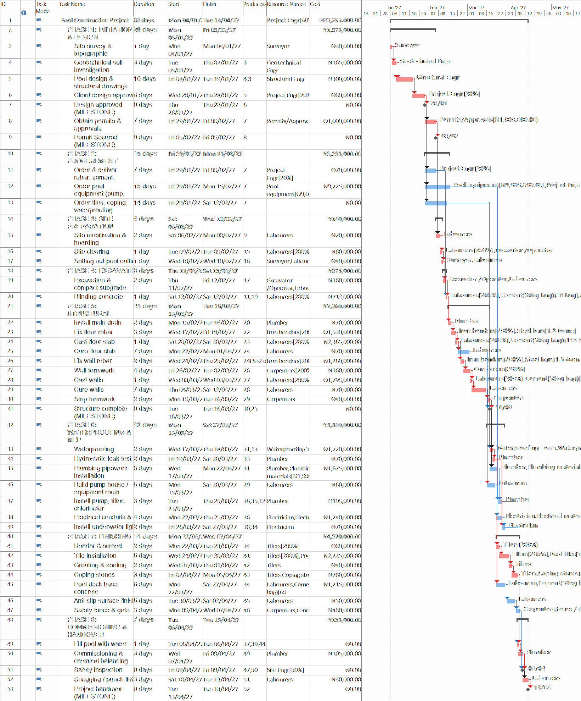
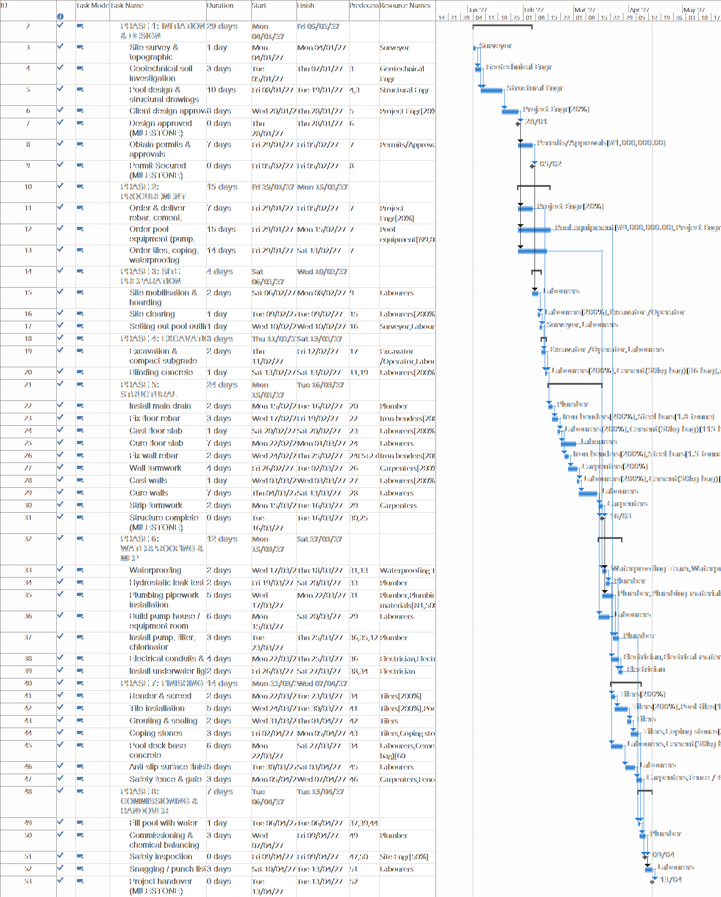
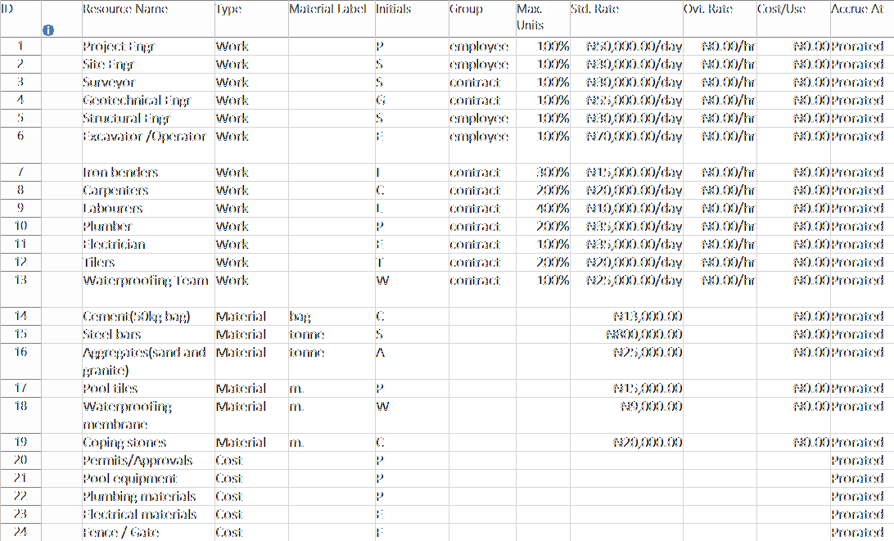

# Residential Swimming Pool Construction: Cost-Loaded Schedule

A resource- and cost-loaded construction schedule for a private residential swimming pool, built in Microsoft Project. It follows the work from site survey to client handover and includes the critical path, a rate-based cost build-up and Gantt views at project start and completion.

## Project at a Glance

| | |
|---|---|
| **Scope** | Excavated, reinforced-concrete pool with waterproofing, plumbing and electrical, tiling, coping, safety fence and commissioning |
| **Duration** | 83 working days (Mon 04 Jan to Tue 13 Apr 2027) |
| **Structure** | 8 phases, 44 tasks, 4 milestones |
| **Total cost** | ₦33,253,000 |
| **Critical tasks** | 32 of 44 |
| **Working calendar** | Mon to Sat; Eid-el-Fitr (10 and 11 Mar) and Easter Monday (29 Mar) excluded; Good Friday worked |
| **Tool** | Microsoft Project |

## Schedule Visuals

**1. Gantt chart at project start (0% complete)**

All 44 tasks with duration, dates, predecessors, resources and cost beside the timeline. Red bars are critical tasks and blue bars have float.

**2. Gantt chart at project completion (100%)**

Every task marked complete. Finished work shows blue because Microsoft Project does not flag completed tasks as critical.

**3. Resource sheet**

Day rates and unit costs behind every cost figure.

## Work Breakdown and Cost

| Phase | Start | Finish | Days | Cost (₦) |
|---|---|---|---|---|
| 1 Initiation & Design | 04 Jan | 05 Feb | 29 | 1,575,000 |
| 2 Procurement | 29 Jan | 15 Feb | 15 | 9,295,000 |
| 3 Site Preparation | 06 Feb | 10 Feb | 4 | 140,000 |
| 4 Excavation | 11 Feb | 13 Feb | 3 | 873,000 |
| 5 Structural Works | 15 Feb | 16 Mar | 24 | 7,360,000 |
| 6 Waterproofing & MEP | 15 Mar | 27 Mar | 12 | 4,440,000 |
| 7 Finishing | 22 Mar | 07 Apr | 14 | 4,870,000 |
| 8 Commissioning & Handover | 06 Apr | 13 Apr | 7 | 135,000 |
| Project oversight (Project Engr 50%, Site Engr 100%) | 04 Jan | 13 Apr | 83 | 4,565,000 |
| **Total** | | | | **33,253,000** |

**Milestones:** Design approved (28 Jan), Permit secured (05 Feb), Structure complete (16 Mar), Project handover (13 Apr).

## Critical Path

The finish date is set by one chain of 32 zero-float tasks running from site survey to project handover, so a delay to any of them delays the whole project. Procurement has float: pool equipment 36 days, tiles, coping and waterproofing materials 24 days, and rebar, cement and aggregates 6 days. The pump house, pool deck base, anti-slip finish and safety fence have only 2 days of float and are near-critical.
